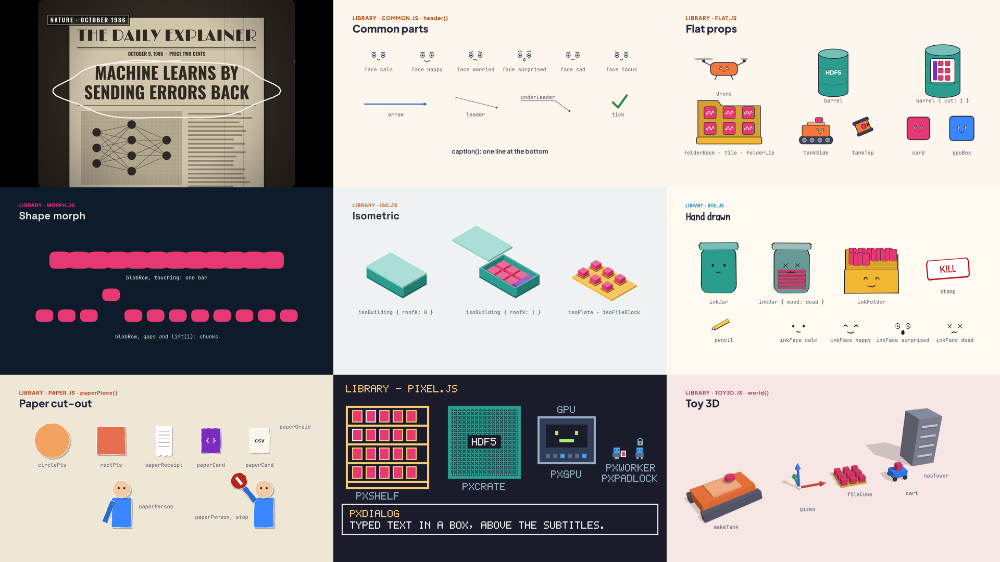
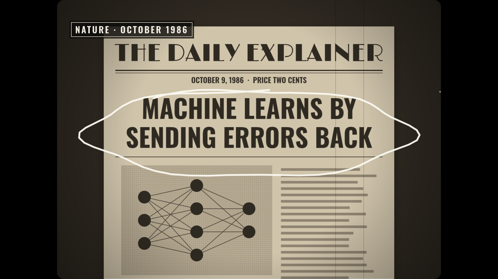
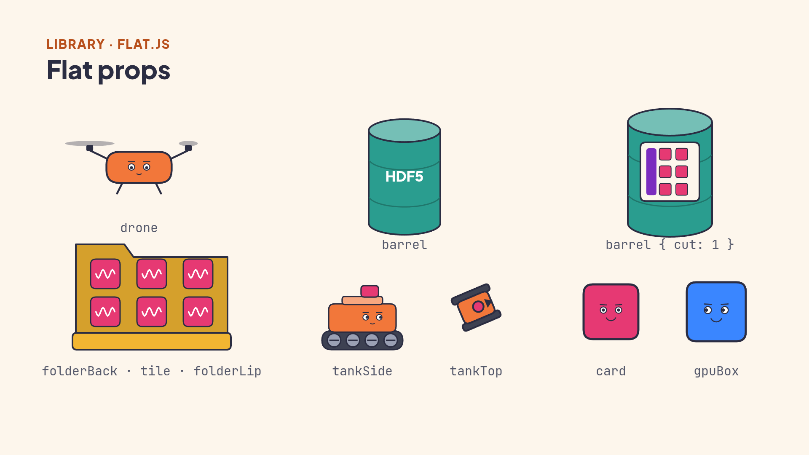
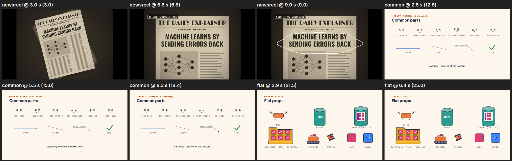

<div align="center">

# Kaleidoscope

A Claude Code skill that makes a narrated teaching video about a topic.<br>
Every picture is 3D, in one clay look, with the same silent mascot in every video. One agent checks the script before the voice is made.



<sub>Code draws every frame in all 29 styles, without a video model, and makes the music and the sound effects. The voice runs on your own computer, with or without a GPU.</sub>

<a href="https://jjietay.github.io/kaleidoscope/"><b>Open the gallery page</b></a>

</div>

## Pipeline


## What makes it different

| A new style for each part | Characters that act | Checked before render |
|:---:|:---:|:---:|
|  |  |  |
| Each idea gets the style that explains it best, for example a newsreel for the history of an idea and Manim for a formula. | Objects can have faces and move like real objects. The tank rolls in, and a block drops and settles. | Claude reads contact sheets like this one. Then a fact checker, a first-time learner and four picture checkers review the video. |

## Try it

In Claude Code, in the conversation where the topic came up:

> Make a video explaining how the EKF fuses wheel odometry and the IMU.

> Make a video on I2C for the BNO085, and tell its history as a 1920s newsreel.

## Styles

| Kind | Styles |
|---|---|
| Maths and diagrams | `math-manim` `signal-graph` `pixel-grid` `single-line` `shape-morph` `whiteboard` `blueprint` |
| Characters and stories | `flat-vector` `line-boil` `paper-cutout` `pixel-art` `midcentury-toon` `watercolour` `risograph` |
| 3D and space | `isometric` `iso-infographic` `toy-3d` `teardown` `desktop-flythrough` `transit-map` |
| Data and evidence | `data-story` `data-physical` `briefing-board` `telestrator` `swiss-type` `dark-keynote` `hud-terminal` `film-crt` `newsreel` |

[`styles/README.md`](styles/README.md) says which style fits which kind of idea.

## Install

```bash
npx kaleidoscope-video
```

The setup checks your machine, asks 4 questions (folder, voice, Manim, script agent), shows the plan, and installs only what you choose. It works without a GPU: then the Kokoro voice speaks and the CPU draws the frames.

Later, in Claude Code, `/setup-kaleidoscope` changes the voice, the GPU or the temperature guard.

[`INSTALL.md`](INSTALL.md) has the manual setup.

## How a video gets checked

The engine measures, and a reader looks. A long build starts only after both.

| Step | Stops on |
|---|---|
| `make look` after each edit | a collision on any frame of a changed scene, text covered by a 3D thing, a loose hand, a walk that goes wrong, a sentence that says something moves when nothing moves |
| `make build` | a changed scene with no look, then any collision or scene error |
| `make final` | a source that changed after the look or the build, an open overlap, or movement strips that nobody read |

Each image from a look has a CHECK digit, and the gates open only with the digits of all images, so a look
must read each one. [`reference/faults.md`](reference/faults.md) lists every fault that has happened and what
stops it now, and `make selftest` plants each one and confirms that the engine catches it.

## Repo layout

| Path | What it holds |
|---|---|
| `SKILL.md` | the workflow the agent follows, step by step |
| `bin/`, `package.json` | the setup that `npx kaleidoscope-video` runs |
| `setup/` | the `/setup-kaleidoscope` skill: voice, GPU and temperature guard |
| `SOUND.md` | the background music and the sound effects: rules, approved tracks and sounds, levels |
| `agents/` | the script agent; the install links it into `~/.claude/agents` |
| `engine/` | the self-test in `test/`, the command line `make.mjs`, the page runtime, fonts, the voice in `tts/`, the music in `music.mjs`, the sound effects in `sfx.mjs`, Manim in `manim/`, and the project template |
| `reference/` | the engine API, the script rules and the fault register |
| `styles/` | one guide per style, the clay kit and the shared drawing code in `styles/library/`, and the credits |
| `gallery/` | one sample project, with its pictures in `png/`, 30 s previews of the music tracks in `music/` and of the sound effects in `sfx/` |

## Credits

Kaleidoscope is under the MIT licence: see [`LICENSE`](LICENSE).
We adapted 11 styles from [Lemo-Opuscar](https://github.com/lemomo-ai/lemo-opuscar) by LemoLab and took details from it for 3 more.
Its MIT licence is in [`styles/LICENSE-opuscar`](styles/LICENSE-opuscar).
[explainroo](https://github.com/vincentsch/explainroo) times the words, [Chatterbox](https://github.com/resemble-ai/chatterbox) speaks the narration,
and [Manim Community](https://www.manim.community/) draws the maths scenes. The fonts use the SIL Open Font License.
