<div align="center">

<h1><picture><source media="(prefers-color-scheme: dark)" srcset="https://raw.githubusercontent.com/jjietay/clayducation/main/gallery/logo/logo-dark-1200.png"></picture></h1>

A Claude Code skill that makes a narrated teaching video about a topic.<br>
<b>New:</b> soft 3D clay with a silent mascot who does the work. The classic 2D styles are still there.<br>One agent checks the script before the voice is made.

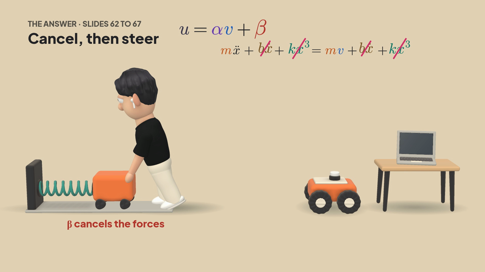

<sub>Code draws every frame, without a video model, from 68 clay models of our own, and makes the music and the sound effects. The voice runs on your own computer, with or without a GPU.</sub>

<a href="https://jjietay.github.io/clayducation/"><b>Open the gallery page</b></a>

</div>

## Pipeline

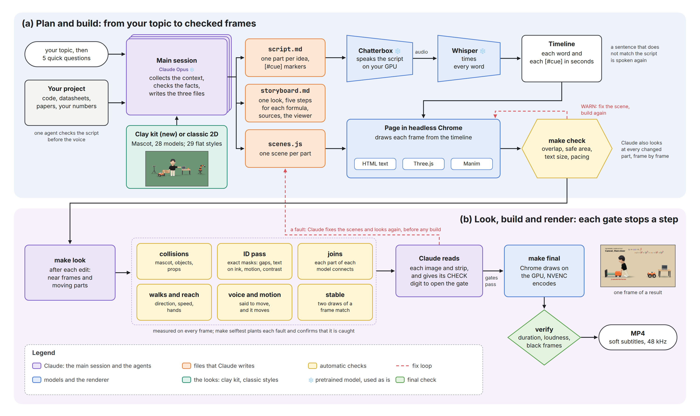

## What makes it different

| A mascot who does the work | Formulas that act | Checked before render |
|:---:|:---:|:---:|
| 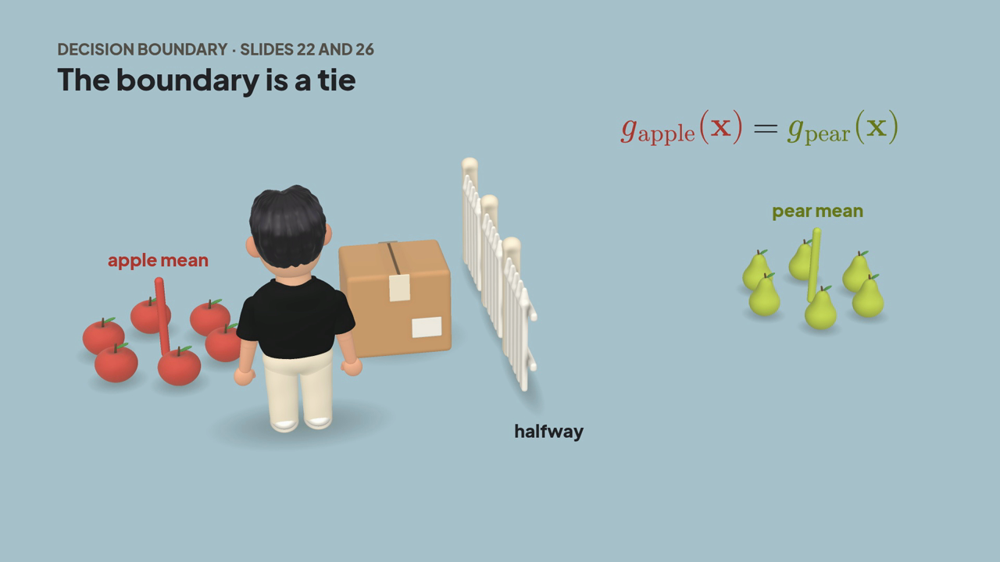 | 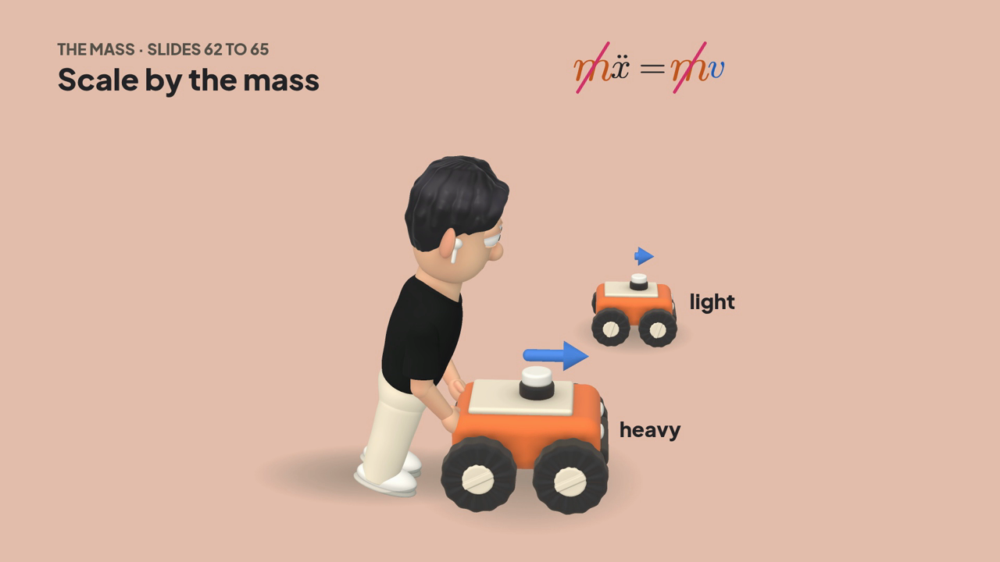 | 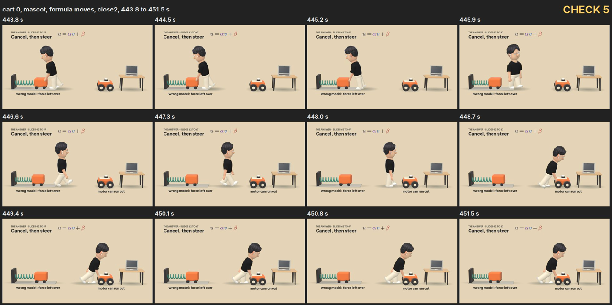 |
| The same silent mascot is in every video. He pulls, pushes and holds the things that the voice talks about. | When the voice says a term moves, it moves. When it says the mass cancels, the two terms are struck out and fly together. | The engine measures every frame. Claude reads strips of every movement like this one before the render can start. |

## Try it

In Claude Code, in the conversation where the topic came up:

> Make a video explaining how the EKF fuses wheel odometry and the IMU.

> Make a video on why computed torque control works.

> Make a video on how backpropagation was discovered, and tell its history as a newsreel.

## Two looks

### New: clay, with a mascot

The default for every video: soft 3D clay, plain backgrounds and flat text, 94 models that we made in
code, and one silent mascot who pulls, pushes and holds the things that the voice talks about.
[`styles/clay.md`](styles/clay.md) has the mascot, his controls and every model.

| Mahalanobis distance | PCA | k nearest neighbours |
|:---:|:---:|:---:|
| 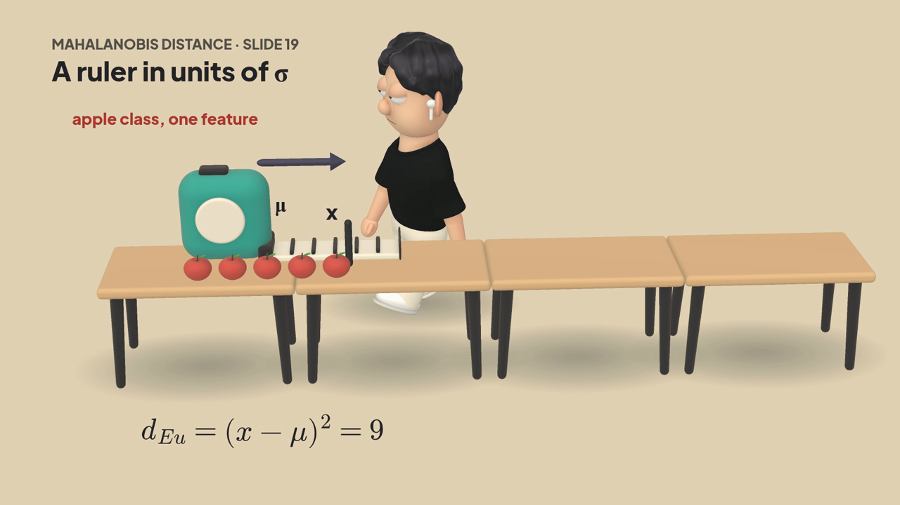 | 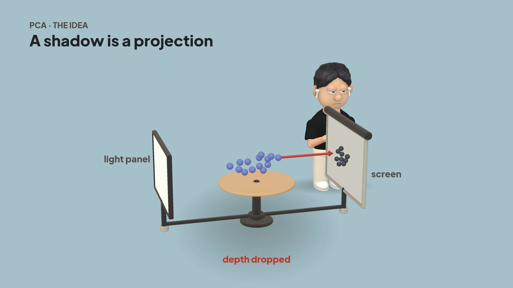 | 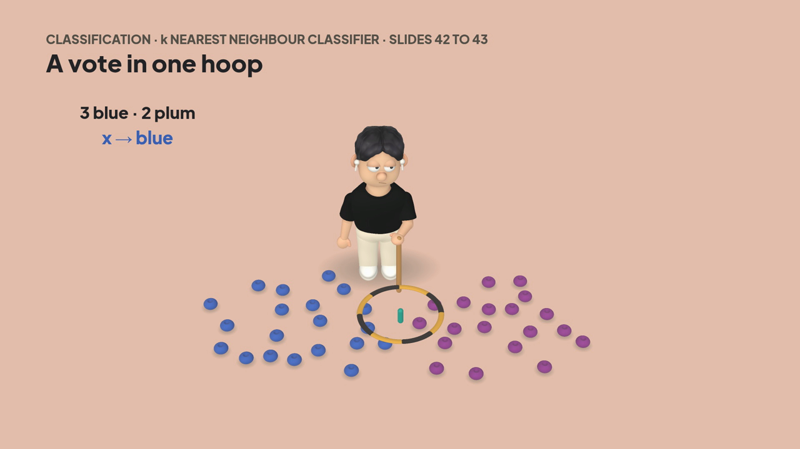 |
| **Bayes decision** | **LDA** | **Generalization** |
| 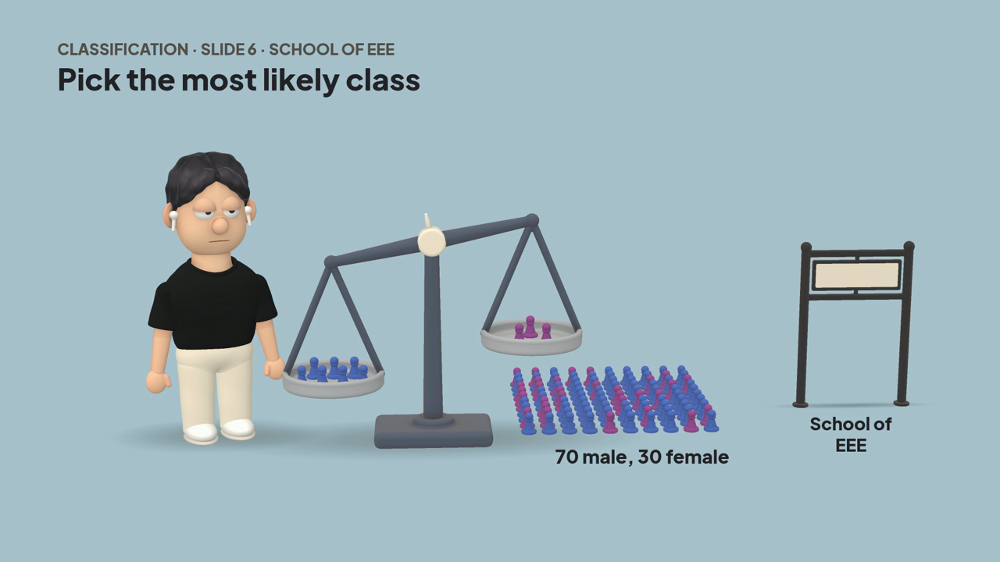 | 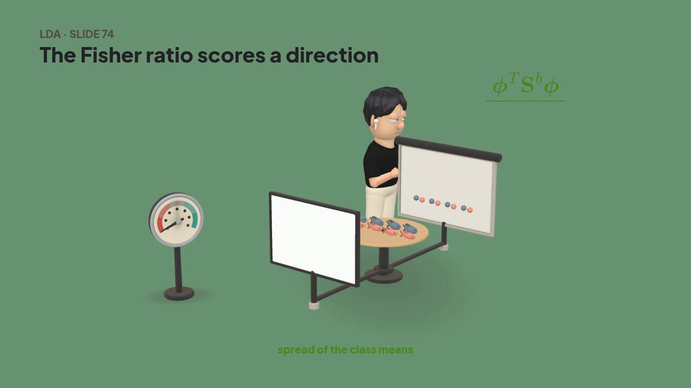 | 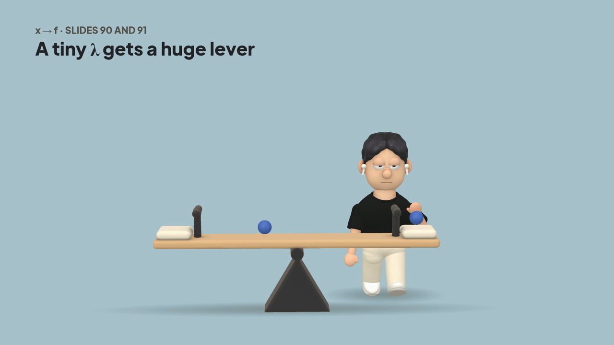 |

Frames from a series of six videos on image processing and computer vision.

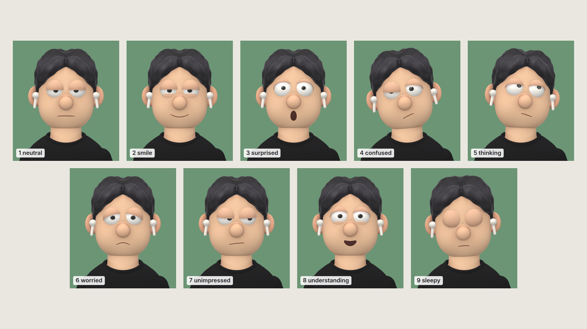

He does the work with his own hands, and a different action can go in each part of a video. He carries,
crouches to lift, sits, kneels, types, writes on a board, throws, knocks, presses, and grips a door handle, a lever
or a wheel while it moves. He kicks a ball, jumps, hammers a nail in and pulls it out with the claw, sweeps dust
with a broom, waters a plant that grows and flowers, and lies down to rest. He can also point, nod, shake his head
and shrug. Each action is one helper in
[`styles/library/clay.js`](styles/library/clay.js). The helpers place his hands with the same contact
measures as the rest of the video, so a hand that misses or goes into a thing is a fault before the render.

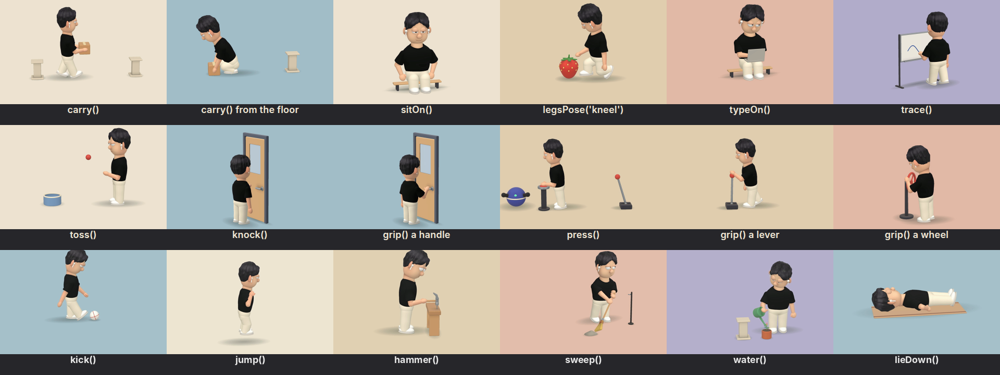

### Classic: 29 flat styles

The first version's 2D styles, one style for each part of a video. Ask for them by name, for example
"tell its history as a newsreel". They use the same workflow and the same checks as clay; see
[`styles/classic/README.md`](styles/classic/README.md).

| Newsreel | Flat vector | Line boil |
|:---:|:---:|:---:|
|  | 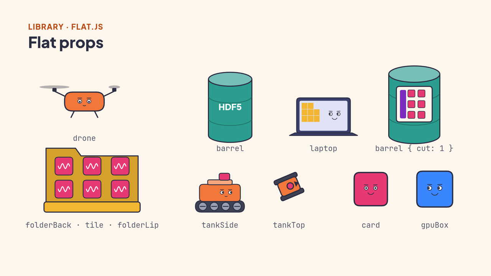 | 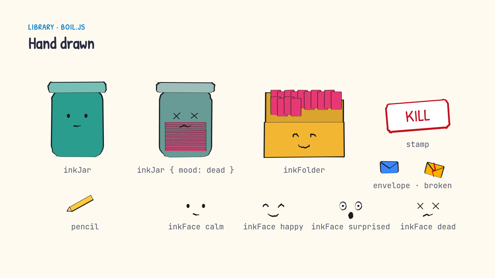 |
| **Pixel art** | **Risograph** | **Blueprint** |
| 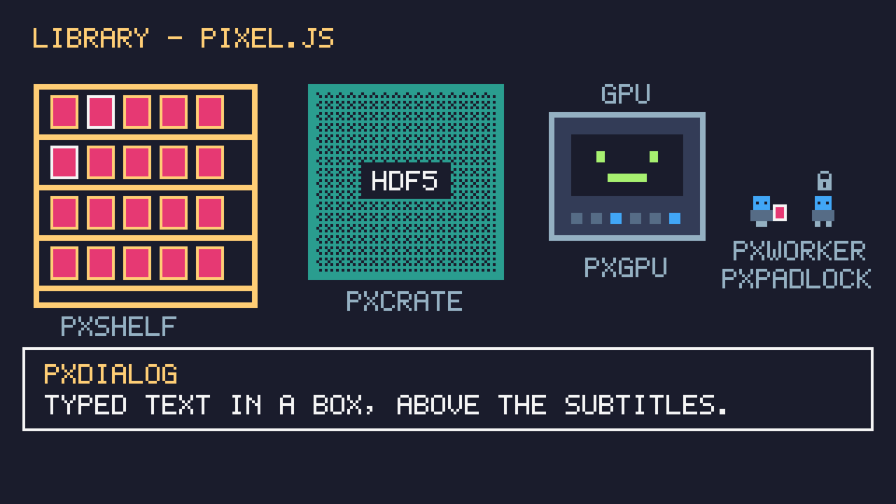 | 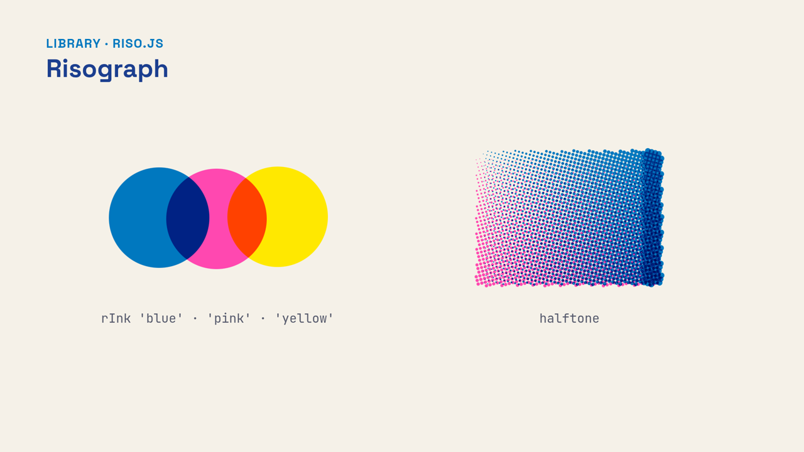 | 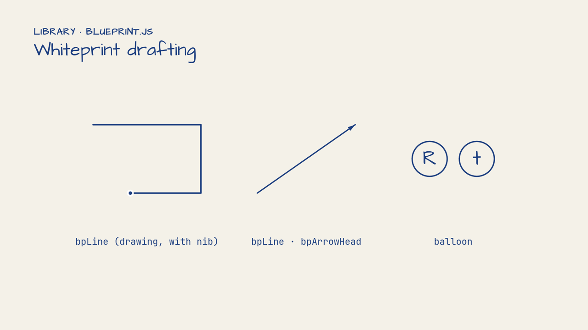 |

## Install

```bash
npx clayducation
```

The setup checks your machine, asks 4 questions (folder, voice, Manim, script agent), shows the plan, and installs only what you choose. It works without a GPU: then the Kokoro voice speaks and the CPU draws the frames.

Later, in Claude Code, `/setup-clayducation` changes the voice, the GPU or the Whisper model.

Clayducation had the name Kaleidoscope before November 2026. If you have the old install in
`~/.claude/skills/kaleidoscope`, run `npx clayducation`. It moves that folder to
`~/.claude/skills/clayducation`, keeps the voice and Manim environments, and updates it.

**GPUs.** An NVIDIA GPU speaks the voice, draws the frames and encodes the video. On a Mac with Apple
silicon, the voice runs on Metal, Chrome draws with Metal and VideoToolbox encodes (the Mac path is new
and not yet tested on a Mac; without a GPU the engine uses the CPU and makes the same frames, slower).

**Whisper.** `make config --whisper large` times the words and checks the voice with Whisper large-v3-turbo
in place of the small base.en. On a test video it placed the cues within 0.01 s of where the speech
starts, against 0.05 to 0.1 s with the small model. The installer chooses it on an NVIDIA GPU.

**Disk space** (estimates for a new install):

| Install | About |
|---|---|
| Everything, NVIDIA GPU: Chatterbox voice, large Whisper, Manim | 12 GB |
| Everything, Mac: Chatterbox on Metal, Manim with BasicTeX | 7 GB (12 GB with the full MacTeX) |
| Smallest: Kokoro voice, no Manim | 1.5 GB |

The biggest parts are PyTorch for the voice (about 5 GB with CUDA), the Chatterbox model (3 GB), the large
Whisper (1.6 GB), and explainroo with its small models (1 GB). Chrome, Node and ffmpeg add about 0.6 GB if
they are not installed yet.

**Updates.** The setup installs the newest release (a `vX.Y.Z` tag). Once a day, the skill checks for a
newer release. If there is one, it shows you what changed ([`RELEASES.md`](RELEASES.md)) and asks
whether to update before the video. You can also update at any time with
`node ~/.claude/skills/clayducation/bin/update.mjs --apply`. Your settings stay. To follow the newest
work on `main` before it is released, run `npx clayducation --main`.

[`INSTALL.md`](INSTALL.md) has the manual setup.

## Before it starts

When the skill starts, Claude asks up to five questions with clickable options, and skips any that your
request already answers: the look (clay, or the classic 2D styles), who the video is for, the length,
when to check with you (one shot, after the storyboard, or after the first frames), and the music.

## How a video gets checked

The engine measures, and a reader looks. A long build starts only after both.

| Step | Stops on |
|---|---|
| `make look` after each edit | a collision on any frame of a changed scene, text covered by a 3D thing, a loose hand, a walk that goes wrong, a sentence that says something moves when nothing moves, a voice whose words were not matched |
| `make build` | a changed scene with no look, then any collision or scene error |
| `make final` | a source that changed after the look or the build, an open overlap, or movement strips that nobody read |

Each image from a look has a CHECK digit, and the gates open only with the digits of all images, so a look
must read each one. An ID pass also makes an exact mask of every text, drawing and model: it sees drawings
that move, warns about text closer than 12 px to anything, text on a drawing, low contrast and hidden models,
and adds one image of the tightest gaps. [`reference/faults.md`](reference/faults.md) lists every fault that has happened and what
stops it now, and `make selftest` plants each one and confirms that the engine catches it.

## Repo layout

| Path | What it holds |
|---|---|
| `SKILL.md` | the workflow the agent follows, step by step |
| `bin/`, `package.json` | the setup that `npx clayducation` runs, and the update check (`bin/update.mjs`) |
| `setup/` | the `/setup-clayducation` skill: voice and GPU |
| `SOUND.md` | the background music and the sound effects: rules, approved tracks and sounds, levels |
| `agents/` | the script agent; the install links it into `~/.claude/agents` |
| `engine/` | the self-test in `test/`, the command line `make.mjs`, the page runtime, fonts, the voice in `tts/`, the music in `music.mjs`, the sound effects in `sfx.mjs`, Manim in `manim/`, and the project template |
| `reference/` | the engine API, the script rules and the fault register |
| `styles/` | the clay look (`clay.md`), Manim for formulas, the kit in `styles/library/`, and the classic 2D styles in `classic/` |
| `gallery/` | the gallery page, its pictures in `png/`, 30 s previews of the music tracks in `music/` and of the sound effects in `sfx/` |

## Credits

Clayducation is under the MIT licence: see [`LICENSE`](LICENSE).
[explainroo](https://github.com/vincentsch/explainroo) times the words, [Chatterbox](https://github.com/resemble-ai/chatterbox) speaks the narration,
and [Manim Community](https://www.manim.community/) draws the maths scenes. The fonts use the SIL Open Font License.
